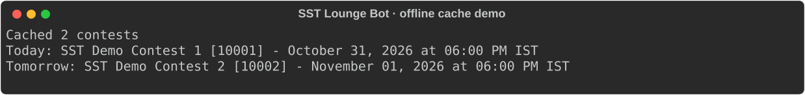
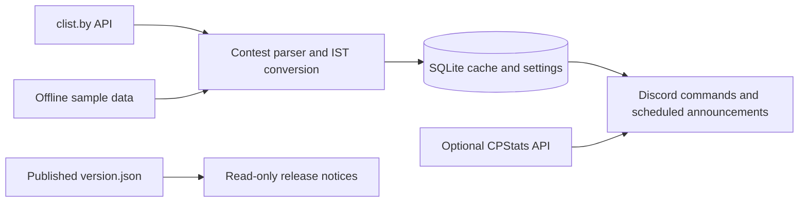

<div align="center">

# SST Lounge Bot

**Bring programming-contest times into the Discord lounge.**

Contest listings, scheduled announcements and a few community tools for the SST Batch '29 Lounge.

[](https://github.com/Muneer320/SST-Lounge-Bot/actions/workflows/ci.yml) [](requirements.lock.txt) [](LICENSE)

[**Try offline**](#try-the-cache-without-credentials) · [**Discord setup**](#connect-your-discord-server) · [**Commands**](#commands-and-operations)

</div>

## Keep the next contest in the conversation

A contest calendar is more useful when people see it where they already talk. This unofficial bot fetches clist.by events, caches them in SQLite and presents dates in IST. Server operators can schedule daily announcements, manage bot admin grants and optionally connect a separate CPStats instance for public-handle ratings.

| Stay aware | Give operators control | Keep state between restarts |
| --- | --- | --- |
| Today/tomorrow/upcoming contest commands and daily announcements | Server-owner admin grants, veteran-role tools and opt-in log export | SQLite settings, stable contest IDs and notification history |



*Real `demo.py` output with synthetic events. It exercises the actual contest parser and SQLite cache; it does not connect to Discord, clist.by or CPStats. Dates depend on the local IST calendar day.*

## Try the cache without credentials

Use Git and Python 3.13+. From a virtual environment or your chosen Python installation:

```sh
git clone https://github.com/Muneer320/SST-Lounge-Bot.git
cd SST-Lounge-Bot
python -m pip install -r requirements.lock.txt
python demo.py
python -m unittest discover -s tests -v
```

The demo prints `Cached 2 contests`, then one sample for today and one for tomorrow. It uses a temporary SQLite database; no `.env` or bot token is needed. Tests cover durable settings/cache, stable IDs, release notices, API boundaries and loading command modules.

## How the bot fits together



> [!NOTE]
> The local demo and automated checks are verified. A live Discord connection, clist credentials and a working optional CPStats deployment are separate requirements. A release notice does not update the running process automatically.

## Connect your Discord server

<details>
<summary><strong>Token, intents, contest credentials and Docker deployment</strong></summary>

Python 3.13+ and a Discord bot token are required. Create a bot in the [Discord developer portal](https://discord.com/developers/applications), enable the **Server Members** and **Message Content** privileged intents, and invite it with `bot` and `applications.commands` scopes. Give it **Manage Roles** only if you use veteran role assignment; its own role must be above the veteran role.

1. Copy `.env.example` to `.env` and set `DISCORD_BOT_TOKEN`.
2. Set `CLIST_API_USERNAME` and `CLIST_API_KEY` for the contest commands. Clist.by requires an API key for API access.
3. Run `python -m pip install -r requirements.lock.txt` and `python run.py`.

The token may also be provided as an environment variable. The bot stores settings, cached contests and notification history in `database/sst_lounge.db`; logs go to `logs/sst_lounge.log`. Both paths are ignored by Git.

### Docker Compose

After creating `.env`, run:

```sh
docker compose up --build -d
docker compose logs -f bot
```

Compose runs one bot process, restarts it after a failure or host restart, and keeps SQLite and logs in named volumes. To deploy a new commit, run `git pull --ff-only` followed by `docker compose up --build -d`. To stop it, run `docker compose down`. Do not run a local `python run.py` at the same time with the same bot token.

</details>

The required and optional names are documented in [.env.example](.env.example). Keep real tokens out of source control and screenshots. Invite/configuration choices affect a real server; the offline demo is available before making those changes.

## Commands and operations

<details>
<summary><strong>Full command table and announcement/release timing</strong></summary>

| Command | Behavior |
|---|---|
| `/contests`, `/contests_today`, `/contests_tomorrow` | Show cached or newly fetched contests in IST, with platform filters |
| `/contest_setup`, `/contest_time`, `/refresh_contests` | Configure and refresh daily announcements; requires admin access |
| `/cp_rating` | Fetch a public handle's rating from CPStats API when configured |
| `/veteran_info`, `/check_veterans` | Inspect or assign the veteran role |
| `/grant_admin`, `/revoke_admin`, `/list_admins` | Manage bot admin grants; grants and revocations require the server owner |
| `/update` | Check published `version.json` and show redeployment instructions; requires admin access |
| `/logs` | Export logs only when the host opts in; requires admin access |
| `/ping`, `/hello`, `/help`, `/contribute`, `/info` | Utility and project information |

Contest cache refresh runs every six hours. Announcements are checked every five minutes and sent once per IST calendar day at the configured time. The bot checks the repository's `version.json` for newer releases and sends each directly granted admin one DM per version. It does not replace its own running process. Role grants do not create notification recipients because a role is not a DM destination.

</details>

<details>
<summary><strong>Optional public-handle ratings through CPStats</strong></summary>

Set `CPSTATS_API_URL` to the running API base URL and `CPSTATS_API_KEY` to that API's bearer token. The public CPStats deployment is currently not verified, so `/cp_rating` reports a configuration or availability error until a working instance is supplied. The bot does not use CPStats for contest listings; those come from clist.by.

</details>

> [!IMPORTANT]
> `/logs` is disabled by default. Logs can contain member IDs, names and server information. Enable export only if the server's operators intend admins to download it. Keep one running bot process for a token and preserve its database when redeploying.

<details>
<summary><strong>Privacy and verified scope</strong></summary>

`/logs` is disabled by default because logs can contain member IDs, names and server information. Set `ENABLE_LOG_EXPORT=true` only if your server's operators have decided to allow admin downloads of that data. The local database and logs are not tracked by Git. This repo includes an offline demo and tests; a live Discord connection and the optional CPStats deployment require credentials and were not verified here.

</details>

## Explore and contribute

See [FEATURES.md](FEATURES.md) for module boundaries and [CHANGELOG.md](CHANGELOG.md) for release history. Report bugs in [Issues](https://github.com/Muneer320/SST-Lounge-Bot/issues) with the command, expected result and a redacted reproduction. For a focused PR, run the offline tests/demo and update configuration/command documentation alongside the change.

An unofficial community project by [Muneer Alam](https://github.com/Muneer320). [MIT license](LICENSE).
